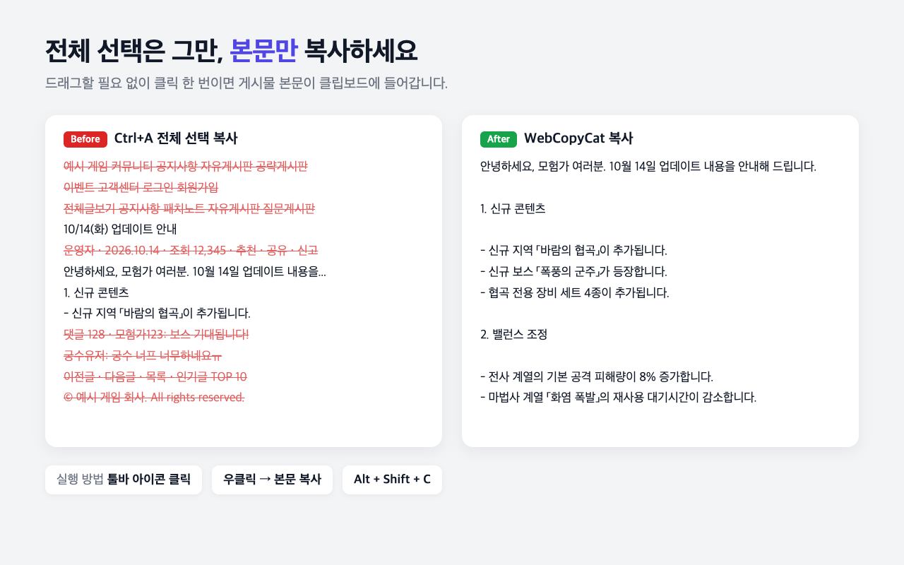

<p align="center"></p>

<h1 align="center">WebCopyCat</h1>

<p align="center">메뉴·댓글·광고 없이, <b>게시물 본문만</b> 클릭 한 번으로 복사하는 Chrome 확장프로그램</p>



## 왜 필요한가요?

- `Ctrl+A`로 전체 선택하면 메뉴, 사이드바, 댓글, 푸터까지 함께 복사됩니다.
- 긴 패치노트를 드래그로 선택하려면 시간이 오래 걸립니다.
- 드래그와 복사를 막아 둔 사이트도 있습니다.

WebCopyCat은 페이지에서 본문 영역을 자동으로 찾아 **일반 텍스트**로 클립보드에 넣습니다.

## 사용법

| 방법 | 동작 |
|------|------|
| 툴바 아이콘 클릭 | 즉시 복사 |
| 우클릭 → **본문 복사 (WebCopyCat)** | 즉시 복사 |
| `Alt+Shift+C` | 즉시 복사 |
| 우클릭 → **영역 선택해서 복사** 또는 `Alt+Shift+X` | 마우스로 원하는 영역을 클릭해 복사 (`Esc` 취소) |

- 복사에 성공하면 아이콘에 `✓`, 실패하면 `!` 배지가 잠깐 표시됩니다.
- **제목 포함:** 툴바 아이콘을 우클릭 → "복사할 때 제목 포함"을 체크하면 첫 줄에 게시물 제목이 붙습니다.
- 단축키는 `chrome://extensions/shortcuts`에서 바꿀 수 있습니다.
- 자동 추출이 엉뚱한 영역을 고르면 **영역 선택 복사**를 쓰세요.

## 동작 원리

1. 사용자가 보고 있는 페이지의 화면 내용(DOM)을 읽습니다. 서버에 다시 요청하지 않으므로 로그인이 필요한 글도 읽을 수 있습니다.
2. 주요 사이트는 **사이트 전용 규칙**(CSS 선택자)으로 본문을 찾습니다. 나머지 사이트는 Firefox 읽기 모드 엔진인 [Mozilla Readability](https://github.com/mozilla/readability)로 본문을 자동 추출합니다.
3. 본문이 iframe 안에 있어도 찾아냅니다 (예: 네이버 카페).
4. CSS로 숨겨진 텍스트(화면 밖 배치, 투명 처리 등)는 복사하지 않습니다.

사이트 전용 규칙은 [`common.js`](common.js)의 `wccSiteRule()`에 있습니다. 현재 등록된 사이트: 넥슨 포럼, 네이버 카페·블로그, 디시인사이드, 인벤, 루리웹, 아카라이브. 잘 안 되는 사이트가 있으면 [이슈](../../issues)로 알려 주세요.

## 개인정보

어떤 데이터도 수집하거나 외부로 전송하지 않습니다. 자세한 내용은 [개인정보처리방침](docs/privacy.md)을 참고하세요.

## 개발

빌드 과정이 없습니다. 폴더를 그대로 Chrome에 로드하면 됩니다.

1. `chrome://extensions` → **개발자 모드** 켜기
2. **압축해제된 확장 프로그램을 로드합니다** → 이 폴더 선택
3. 코드를 수정한 뒤 확장프로그램 카드의 새로고침 버튼 클릭

```bash
npm install
npx playwright install chromium

npm test                 # 테스트 페이지에서 실제 복사 흐름 검증
npm test -- <URL>        # 실제 사이트에서 복사 결과 출력 (사이트 규칙 점검용)
npm run assets           # 아이콘·스토어 이미지 다시 생성
npm run zip              # 웹스토어 업로드용 dist/webcopycat.zip 생성
```

문서: [요구사항](docs/requirements.md) · [로드맵](docs/roadmap.md) · [스토어 등록 문구](store/listing.md)

## 라이선스

[MIT](LICENSE). `lib/Readability.js`는 Mozilla Readability(Apache-2.0)를 그대로 포함한 파일입니다.

본문 복사는 개인적인 이용 목적으로만 사용하세요. 복사한 콘텐츠의 저작권은 원저작자에게 있습니다.
